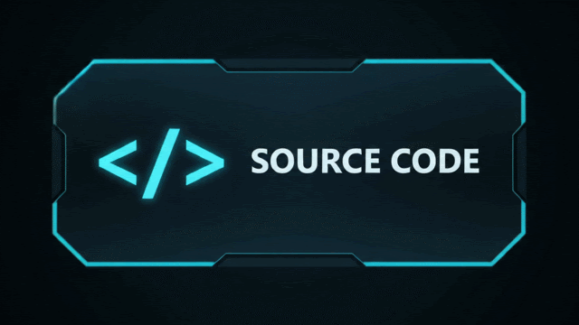
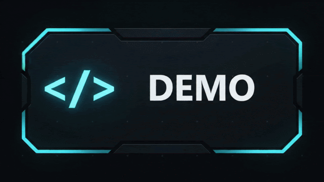
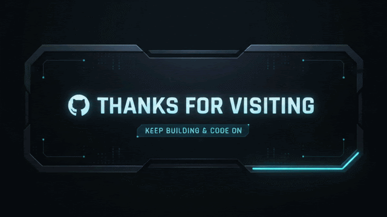

        <!-- MY X-RAY PICTURE -->
        
          
        
        
        
        

 

  

 

        <h3>Technologies & tools</h3>
        
         
        
                <h4>Tools and technologies I work with and continue to explore.</h4>
        

  

        <h1>GITHUB ANALYTICS</h1>

        
        
        
        
        

 

        <h1>My top projects with their source code & demo</h1>
        <h3>-x-{{{ LATEST --->>> OLDEST }}}-x-</h3>

<table>
        <tr>
                <td align="center">
                         
                        
                         
                        
                        
                         
                </td>
        </tr>
        <tr>
                <td align="center">
                         
                        
                         
                        
                        
                         
                </td>
        </tr>
        <!-- <tr>
                <td align="center">
                         
                        
                         
                        
                        
                         
                </td>
        </tr> -->
        <tr>
                <td align="center">
                   
                  
                   
                  
                  
                   
                </td>
        </tr>
        <tr>
                <td align="center">
                         
                        
                         
                        
                        
                         
                </td>
        </tr>
        <tr>
                <td align="center">
                         
                        
                         
                        
                        
                         
                </td>
        </tr>
        <tr>
                <td align="center">
                         
                        
                         
                        
                        
                         
                </td>
        </tr>
        <tr>
                <td align="center">
                         
                        
                         
                        
                        
                         
                </td>
        </tr>
        <tr>
                <td align="center">
                         
                        
                         
                        
                        
                         
                </td>
        </tr>
        <tr>
                <td align="center">
                         
                        
                         
                        
                        
                         
                </td>
        </tr>
        <tr>
                <td align="center">
                         
                        
                         
                        
                        
                         
                </td>
        </tr>
        <tr>
                <td align="center">
                         
                        
                         
                        
                        
                         
                </td>
        </tr>
        <tr>
                <td align="center">
                         
                        
                         
                        
                        
                         
                </td>
        </tr>
        <tr>
                <td align="center">
                         
                        
                         
                        
                        
                         
                </td>
        </tr>
</table>

07 — LET'S CONNECT

