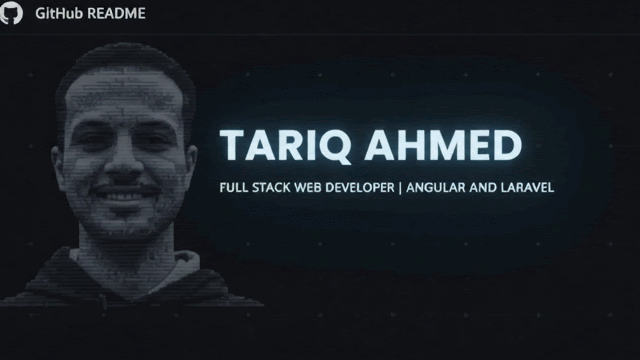

        <!-- MY X-RAY PICTURE -->
        
          
        <!--  -->
        
        
        
        

 

02 — TECH STACK

  Technologies & tools
   
  
   
  Tools and technologies I work with and continue to explore.

03 — GITHUB ANALYTICS

        
        
        

04 — CONTRIBUTION ACTIVITY

top projects with their source code & demo

<table>
  <tr>
    <td align="center">
       
      
       
      
      
       
    </td>
  </tr>
  <tr>
    <td align="center">
       
      
       
      
      
       
    </td>
  </tr>
  <tr>
    <td align="center">
       
      
       
      
      
       
    </td>
  </tr>
  <tr>
    <td align="center">
       
      
       
      
      
       
    </td>
  </tr>
  <tr>
    <td align="center">
       
      
       
      
      
       
    </td>
  </tr>
  <tr>
    <td align="center">
       
      
       
      
      
       
    </td>
  </tr>
  <tr>
    <td align="center">
       
      
       
      
      
       
    </td>
  </tr>
  <tr>
    <td align="center">
       
      
       
      
      
       
    </td>
  </tr>
</table>

06 — CURRENT FOCUS

Mission	Status
Learning new technologies	IN PROGRESS
Building useful projects	IN PROGRESS
Improving development skills	IN PROGRESS
Exploring innovative ideas	IN PROGRESS

07 — LET'S CONNECT

Thanks for visiting my digital space!

