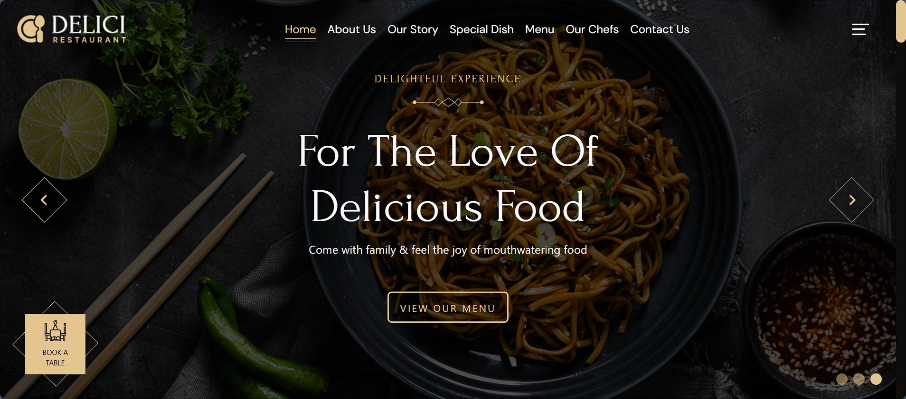
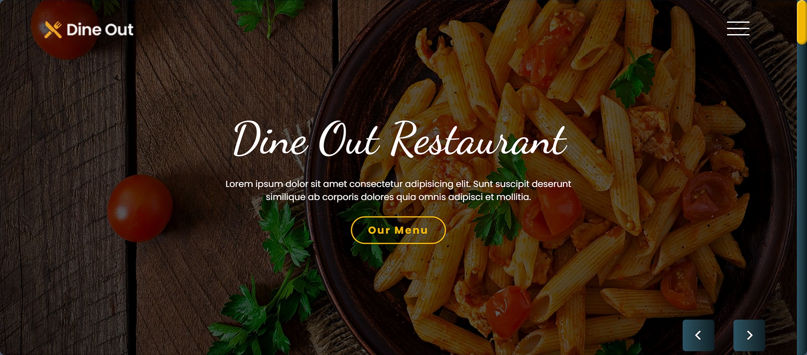
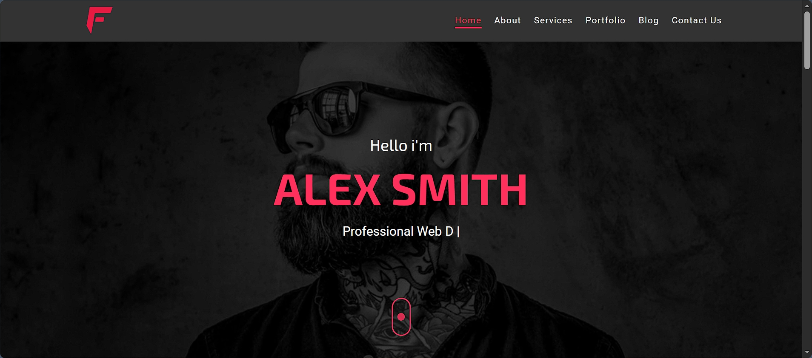

        
        
        
        
        

01 — ABOUT ME
        Building ideas into digital experiences.
        
I'm <strong>Tarouq Ahmed</strong>, a developer passionate about technology, software engineering, and creating meaningful digital experiences.
         
        I enjoy learning, solving problems, and transforming ideas into practical projects.
        

02 — TECH STACK

        Technologies & tools
        Tools and technologies I work with and continue to explore.

03 — GITHUB ANALYTICS

        
        
        

04 — CONTRIBUTION ACTIVITY

05 — FEATURED PROJECTS

Selected work from my development journey.

🍽️ Delici Restaurant

  
  
  
🔷 Dine Out Restaurant

  
  
🌌 Fokir Project

  
  

06 — CURRENT FOCUS

Mission	Status
Learning new technologies	IN PROGRESS
Building useful projects	IN PROGRESS
Improving development skills	IN PROGRESS
Exploring innovative ideas	IN PROGRESS

07 — LET'S CONNECT

Thanks for visiting my digital space!

